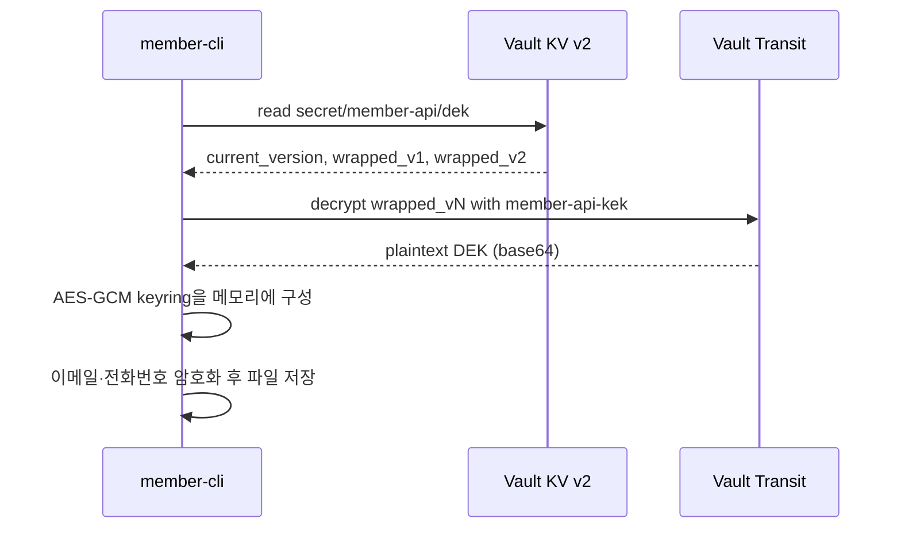

# Vault Transit으로 구현하는 Envelope Encryption

회원 이메일·전화번호를 DB(이 예제에서는 JSON 파일)에 저장할 때 필드 단위로 암호화한다.
암호화 키는 코드나 설정 파일에 두지 않고 HashiCorp Vault에서 관리한다.

- **KEK**(Key Encryption Key): Vault Transit 키 `member-api-kek`. Vault 밖으로 나오지 않는다
- **DEK**(Data Encryption Key): `transit/datakey/wrapped`로 발급한 AES-256 키. KEK로 wrap된 상태로만 KV v2(`secret/member-api/dek`)에 저장한다
- 앱은 시작할 때 wrap된 DEK를 읽고 `transit/decrypt`로 풀어서, 평문 DEK를 **메모리에만** 둔다



## 구성

| 경로 | 내용 |
|---|---|
| `docker-compose.yml` | `hashicorp/vault:2.2.1` dev 모드(메모리 스토리지, 자동 unseal, root token `root`) |
| `policies/member-api.hcl` | 앱 권한: DEK 읽기, KEK로 unwrap |
| `policies/member-api-migration.hcl` | migration 권한: DEK 발급·적재·교체, unwrap. KEK 자체는 다루지 못한다 |
| `scripts/setup.sh` | Transit 활성화, KEK 생성, policy 등록, policy별 token 발급(`.tokens/`). 여러 번 실행해도 결과가 같다 |
| `envelope/` | `Keyring`(버전별 AES-GCM), `InitDEK`/`RotateDEK`/`LoadKeyring`(Vault 연동) |
| `member/` | 회원 필드 암호화 JSON 저장소와 재암호화 |
| `cmd/member-cli/` | 예제 CLI |

KV 문서 구조는 다음과 같다. 회전할 때 옛 버전을 지우지 않아야 옛 데이터를 계속 복호화할 수 있다.

```
current_version = "2"           # 암호화에 쓰는 DEK 버전
wrapped_v1      = "vault:v1:…"  # KEK로 wrap된 DEK v1
wrapped_v2      = "vault:v1:…"  # KEK로 wrap된 DEK v2
```

암호문은 `[1바이트 DEK 버전][12바이트 nonce][AES-GCM 암호문+tag]`이고, 파일에는 base64로 저장한다.

## 사전 준비

- Docker
- Go 1.26 이상

로컬에 `vault` CLI는 필요 없다. 스크립트와 아래 예시는 컨테이너 안의 CLI를 쓴다.

## 실행

### 1. Vault 실행과 초기 설정

```bash
cd cloud/vault
docker compose up -d
./scripts/setup.sh
```

```
Success! Enabled the transit secrets engine at: transit/
Transit KEK ready: member-api-kek
Success! Uploaded policy: member-api
Success! Uploaded policy: member-api-migration
setup done: .tokens/app.token, .tokens/migration.token
```

이후 명령에서 쓸 환경 변수와 함수다.

```bash
export VAULT_ADDR=http://127.0.0.1:8200
APP_TOKEN=$(cat .tokens/app.token)
MIGRATION_TOKEN=$(cat .tokens/migration.token)
vault() { docker compose exec -T -e VAULT_ADDR=http://127.0.0.1:8200 -e VAULT_TOKEN=root vault vault "$@"; }
```

### 2. DEK v1 만들기 (migration token)

```bash
VAULT_TOKEN=$MIGRATION_TOKEN go run ./cmd/member-cli init-dek
VAULT_TOKEN=$MIGRATION_TOKEN go run ./cmd/member-cli init-dek
```

```
DEK v1 created
DEK already exists, skipped
```

KV에는 wrap된 DEK만 들어 있다.

```bash
vault kv get secret/member-api/dek
```

```
========= Data =========
Key                Value
---                -----
current_version    1
wrapped_v1         vault:v1:8zDaIVly51ZlcQq+ulUFAlf0gSV9w7QEj0Cva0TSWp/F5uXVnvVVrwMSK7enqhcqZuO2mQpmco6xe2bz
```

### 3. 회원 저장과 조회 (app token)

```bash
VAULT_TOKEN=$APP_TOKEN go run ./cmd/member-cli put --id alice --email alice@example.com --phone 010-1234-5678
cat data/members.json
VAULT_TOKEN=$APP_TOKEN go run ./cmd/member-cli get --id alice
```

```
saved alice
{
  "members": [
    {
      "id": "alice",
      "email": "ATeT5t1JI4YWCFzDNaCQXN21ibPaigQLYfyTcF1quCVhNrizk+3NCv3m15CpJA==",
      "phone": "AUKZZ/P0spGkjhQx3XN5qcW2fEF2uIC0iaz2zWeAX6KAxmZia+jwq+At"
    }
  ]
}
id=alice email=alice@example.com phone=010-1234-5678
```

### 4. 앱 token으로는 DEK를 바꿀 수 없다

```bash
VAULT_TOKEN=$APP_TOKEN go run ./cmd/member-cli rotate-dek
```

```
error: generate DEK with member-api-kek: Error making API request.

URL: PUT http://127.0.0.1:8200/v1/transit/datakey/wrapped/member-api-kek
Code: 403. Errors:

* 1 error occurred:
	* permission denied
```

### 5. DEK 회전과 재암호화 (migration token)

```bash
VAULT_TOKEN=$MIGRATION_TOKEN go run ./cmd/member-cli rotate-dek
jq -r '.members[0].email' data/members.json | base64 -d | head -c 1 | xxd -p   # 암호문의 DEK 버전
VAULT_TOKEN=$MIGRATION_TOKEN go run ./cmd/member-cli reencrypt
jq -r '.members[0].email' data/members.json | base64 -d | head -c 1 | xxd -p
VAULT_TOKEN=$MIGRATION_TOKEN go run ./cmd/member-cli reencrypt
VAULT_TOKEN=$APP_TOKEN go run ./cmd/member-cli get --id alice
```

```
DEK rotated: current_version=2
01
re-encrypted 1 member(s)
02
re-encrypted 0 member(s)
id=alice email=alice@example.com phone=010-1234-5678
```

회전 뒤에도 `wrapped_v1`은 그대로 남는다.

```
current_version    2
wrapped_v1         vault:v1:8zDaIVly51ZlcQq+ulUFAlf0gSV9w7QEj0Cva0TSWp/F5uXVnvVVrwMSK7enqhcqZuO2mQpmco6xe2bz
wrapped_v2         vault:v1:P61i73WJPrO2k57+v3KNGZO978qZv13qvxmxpdAn4TZtu+tEGSfh0bB8JVwbYbbrxMsXDyPzkX1pN26O
```

### 6. dev 모드에서 Vault를 재시작하면 키를 잃는다

dev 모드는 데이터를 메모리에만 둔다. 재시작하면 KEK와 KV가 모두 사라지고, 다시 설정하면 이름만 같은 **새 KEK와 새 DEK**가 생긴다.

```bash
docker compose restart vault
./scripts/setup.sh
APP_TOKEN=$(cat .tokens/app.token); MIGRATION_TOKEN=$(cat .tokens/migration.token)

VAULT_TOKEN=$APP_TOKEN go run ./cmd/member-cli get --id alice
VAULT_TOKEN=$MIGRATION_TOKEN go run ./cmd/member-cli init-dek
VAULT_TOKEN=$APP_TOKEN go run ./cmd/member-cli get --id alice
VAULT_TOKEN=$MIGRATION_TOKEN go run ./cmd/member-cli rotate-dek
VAULT_TOKEN=$APP_TOKEN go run ./cmd/member-cli get --id alice
```

```
error: DEK not initialized: secret/member-api/dek
DEK v1 created
error: decrypt email of alice: unknown key version: 2
DEK rotated: current_version=2
error: decrypt email of alice: cipher: message authentication failed
```

- 첫 번째 실패: KV가 비어 있다
- 두 번째 실패: 파일의 데이터는 v2로 암호화돼 있는데 새 DEK에는 v1만 있다
- 세 번째 실패: 버전 번호(v2)는 같지만 키가 다르다. AES-GCM이 인증 실패로 거부한다

`data/members.json`은 그대로 남아 있지만 더는 복호화할 수 없다. 실제 운영에서 영구 스토리지와 백업(Raft snapshot)을 쓰는 이유다.

## 테스트

```bash
go test ./...          # Docker 필요: testcontainers로 Vault를 띄우는 통합 테스트 포함
go test -short ./...   # 통합 테스트 제외
```

## 정리

```bash
docker compose down
rm -rf data .tokens
```

## 관련 글

- HashiCorp Vault 실전 가이드 1편 - 핵심 개념과 Transit으로 구현하는 Envelope Encryption (발행 예정)
